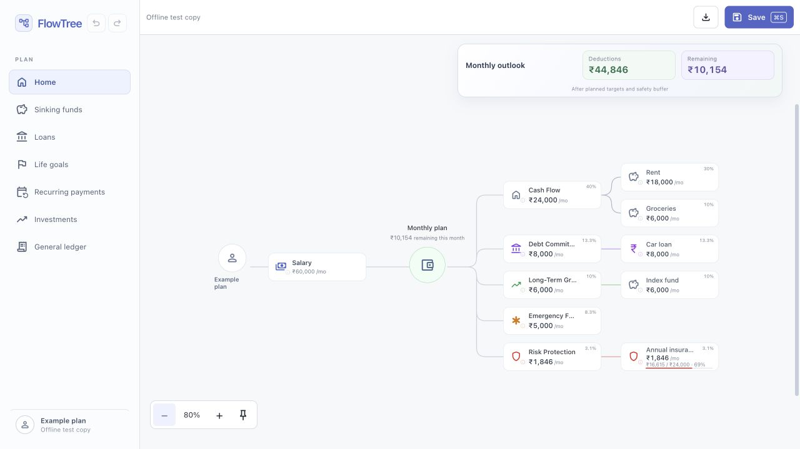
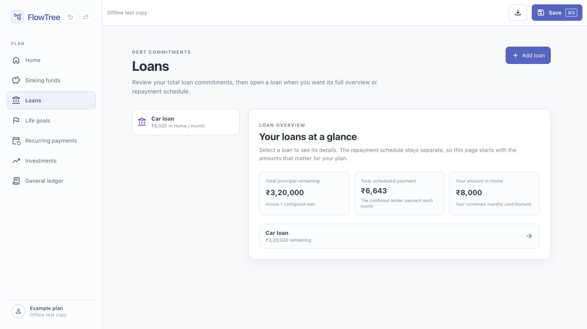

# FlowTree

**See where your monthly money is planned to go.**

FlowTree turns your income, bills, loans, and goals into a visual money plan. Follow the branches from income to categories to individual expenses, and see what remains after your targets and safety buffer.

**[Open FlowTree](https://flowtree.flowtreeapp.workers.dev/)** · [User guide](./docs/USER_GUIDE.md) · [PDF guide](./docs/FlowTree-User-Guide.pdf)



*Screenshots use made-up example data in a local test copy. The live app uses Google Drive for saving.*

## What can I do with it?

| View | What it helps you do |
| --- | --- |
| **Home** | See your whole monthly plan and the money remaining after targets and your safety buffer. |
| **Sinking funds** | Plan monthly set-asides for upcoming yearly expenses, such as insurance. |
| **Loans** | Review monthly commitments and explore repayment projections. |
| **Life goals** | Plan towards a target amount and date. |
| **Recurring payments** | Review regular planned payments. |
| **Investments** | Track monthly contributions and values you enter yourself. |
| **General ledger** | Record expenses separately from your monthly plan. |

### A closer look at loans

See what you still owe, the scheduled monthly payment, and the amount you have included in your plan. Open a loan to review its repayment schedule.



## Get started

1. **Open the app** and use **Account** to sign in to Google Drive to restore or save your plan.
2. **Add your income and safety buffer**, then add expenses and goals under the relevant categories.
3. **Explore your plan.** Open or close branches on Home, or switch to a dedicated view for more detail.
4. **Save your changes** with **Save to Google Drive** before closing the app. You can also download a JSON backup.

Your plan is a preview: FlowTree does not connect to your bank or move money. Investment values and savings progress are manually entered or projected, rather than live account balances.

## Your data and saving

- Your active plan stays in memory while the tab is open. Save before closing it.
- Google Drive saves a plan in your own account. Changes are saved when you choose **Save**.
- Download a JSON backup when you want a separate copy.
- Switching between views does not save the plan.

Read the [privacy policy](./public/privacy.html) and [terms](./public/terms.html) for details.

## Use it like a phone app

Choose **Account → Install Flowtree** when available. On iPhone or iPad, open the site in Safari and choose **Share → Add to Home Screen**. On Android, use your browser's **Install app** or **Add to Home screen** option.

An internet connection is needed for Google sign-in, restoring, and saving. Opening the app offline shows a reconnect screen. If you lose connection while editing, keep the app open and reconnect before saving.

When **Update ready** appears, save your changes, close all FlowTree windows, and reopen the app.

---

## Technical details

Everything below is for developers and readers who want implementation details.

### Stack and local setup

React 19, plain JavaScript/JSX, Vite, component CSS, Node's built-in test runner, and Oxlint. There is no custom backend. Google Drive integration uses Google Identity Services and the Drive API.

Use Node.js 22, as in the deployment workflow:

```sh
npm ci
npm run dev
```

Open the URL printed by Vite; the port can vary.

### Commands


| Command | Purpose |
| --- | --- |
| `npm run dev` | Start Vite's development server with hot updates |
| `npm run build` | Create the production bundle in `dist/` |
| `npm run preview` | Serve the latest production build locally |
| `npm run lint` | Run Oxlint |
| `npm test` | Run the domain tests with Node's test runner |

Before handing off a code change, run:

```sh
npm test
npm run lint
npm run build
```

### Financial model


The allocation preview is deterministic:

1. Reserve the safety buffer from monthly income.
2. Visit top-level categories in their visible array order.
3. Give each category up to its monthly target before funding the next category.
4. Within a parent, reserve the parent's direct amount first and pass the rest to its children in order.
5. Convert yearly targets to monthly equivalents by dividing by 12.

For dated yearly targets, expected progress is recalculated from the rolling 12-month cycle. Dated-target editors share a compact Card setup option: Fresh or Already started. Fresh uses today as the start; Already started exposes the start date. Fixed monthly bills, loans, investments, and income do not show this setup option. Existing stored dates are preserved; income retains its normal Starts on field. Monthly amounts and lender projections retain their own calculations. Dated targets use the start/end schedule. A Life goal uses this dated schedule. Its schedule includes both the start and target months. Expected saved progress counts planned contributions before the current month, keeping any higher recorded savings. The remaining amount is spread over the remaining contribution months, including this month once the schedule has started. A fresh active goal is included in the current monthly plan; paused goals still show their requirement without reserving money. This remains planning information and never moves money automatically.

The useful plan summary is:

```text
available = income - safety buffer - monthly targets
```

The interface shows **Deductions** in green and signed **Remaining** in purple, including negative values. These are plan-preview amounts, not an account balance.

### JSON backup and import

<details>
<summary>Plan format, validation, and example JSON</summary>


Use **Account → Edit plan JSON** to open the current plan in Flowtree. You can edit it directly; Flowtree validates the JSON before replacing the active plan, then lets you save the validated version using **Save to Google Drive**.

Import replaces the current plan. Export the current plan first when you may want to restore it later. Files larger than 2 MB, duplicate IDs, negative amounts, invalid dates, unknown statuses, excessive nesting, and unsupported export versions are rejected before any saved data changes.

The Drive file is intentionally a plain plan object—there is no wrapper, metadata, or export timestamp. You can also create or edit it outside Flowtree:

```json
{
  "profile": { "name": "You" },
  "incomeSources": [
    { "id": "salary", "name": "Salary", "amount": 60000 }
  ],
  "buffer": 5000,
  "tree": [
    {
      "id": "cash-flow",
      "name": "Cash Flow",
      "amount": 0,
      "children": [
        { "id": "rent", "name": "Rent", "amount": 18000, "children": [] },
        { "id": "insurance", "name": "Insurance", "amount": 12000, "period": "year", "dueDate": "2027-09-20", "children": [] }
      ]
    }
  ]
}
```

Authoring rules:

- Every income source and destination needs a unique, non-empty `id` within its own list.
- `amount`, `savedAmount`, and `buffer` are JSON numbers greater than or equal to zero. Do not put them in quotation marks.
- `period` is `"month"` or `"year"`.
- `status` is `"active"` or `"inactive"`. Inactive items pause allocation for their entire branch. Older `"seeded"` values import as active; `"dormant"` and `"funded"` import as inactive.
- Destination `startDate` is optional and editable even while inactive; it records a planning date and does not automatically activate an item. `dueDate` is optional and uses `YYYY-MM-DD`; it is normally used with yearly targets. Life goals support editing both dates.
- Income `startDate` is optional and uses `YYYY-MM-DD`; `dayOfMonth` is optional and is an integer from 1 to 31 (default: 1). These fields describe the expected monthly income cadence for planning only; Flowtree does not schedule transfers.
- `children` is always an array. Use `[]` for the end of a branch, or nest more destination objects to continue the hierarchy.
- `savedAmount`, `dueDate`, `icon`, `tone`, and `note` are optional. Missing optional values receive safe defaults.
- An investment can include optional metadata: `"investment": { "type": "Mutual fund", "currentValue": 125000 }`. Its node `amount` remains the monthly contribution; `currentValue` is a user-entered record only.
- Versioned Flowtree exports from earlier releases are still accepted for compatibility.

</details>

### Google Drive configuration


Google Drive sign-in is optional. The app asks the user to sign in with their own Google account, creates or uses an app-owned private `gpt` folder, restores a valid `flowtree-plan.json` when it exists, and saves later plan changes only when you choose **Save to Google Drive**. If duplicates exist, the newest valid files are shown first for an explicit restore choice. No Google credentials are stored in FlowTree data or committed to the repository.

The public [privacy policy](./public/privacy.html) and [terms](./public/terms.html) describe the limited Google Drive access used by the app.

To enable the feature for a deployed site, create a Google OAuth web client, add the deployed site origin to its authorised JavaScript origins, then add its client ID in the GitHub repository variable `GOOGLE_OAUTH_CLIENT_ID`. The deploy workflow passes that public OAuth client ID to Vite as `VITE_GOOGLE_CLIENT_ID`. See [Google Drive sync setup](./docs/GOOGLE_DRIVE_SYNC.md).

### Deployment and PWA

Pushing to `main` runs the GitHub Pages workflow, builds with the `/flowtree/` base path, and publishes `dist/`. Set **Settings → Pages → Source** to **GitHub Actions**.

The service worker caches static app assets only. Google requests, credentials, and plan JSON are not cached. Unsaved plans are not persisted offline and uploads are not queued. Updates wait until existing app windows close.

PWA registration runs only in production builds. To test the GitHub Pages path locally:

```sh
VITE_BASE_PATH=/flowtree/ npm run build
VITE_BASE_PATH=/flowtree/ npm run preview -- --host 127.0.0.1 --port 4173
```

Open `http://127.0.0.1:4173/flowtree/`. The normal Vite development server and private offline test copy do not register a worker. Icons can be regenerated with `python3 scripts/generate-icons.py` (no dependencies).
### Project map


| Path | Role |
| --- | --- |
| `src/main.jsx` | React root and Strict Mode |
| `src/App.jsx` | App composition, dialogs, and persistent actions |
| `src/features/flowtree/EnergyExplorer.jsx` | View composition, navigation, and allocation-derived presentation |
| `src/features/flowtree/TreeCanvas.jsx` | SVG connectors, root node, and positioned tree cards |
| `src/features/flowtree/treeLayout.js` | Pure column, subtree-band, and connector layout calculation |
| `src/features/flowtree/PlanDialog.jsx` | Income, buffer, node-editing, and child-creation dialogs |
| `src/features/flowtree/LoansView.jsx` | Loan inputs, payoff overview, and amortization schedule |
| `src/features/flowtree/GoalsView.jsx` | Dedicated Life goals creation and overview |
| `src/features/flowtree/InvestmentsView.jsx` | Dedicated Long-Term Growth investment creation and overview |
| `src/features/flowtree/EnergyExplorer.css` | Active visual system |
| `src/domain/flowTree.js` | Tree operations and monthly totals |
| `src/domain/energyFlow.js` | Pure plan-allocation algorithm |
| `src/domain/loan.js` | Pure monthly-payment and payoff schedule calculation |
| `src/hooks/useFlowData.js` | In-memory plan state and mutations |
| `tests/domain/*.test.js` | Domain tests |

The earlier prototype screens, styles, and unused assets were removed. The active home screen is fully contained in `src/features/flowtree/`.

## Documentation

- [`AGENTS.md`](./AGENTS.md) — repository working rules
- [`REACT.md`](./REACT.md) — React architecture and coding conventions
- [`VITE.md`](./VITE.md) — development, assets, environment variables, and deployment
- [`DESIGN.md`](./DESIGN.md) — accepted visual and interaction system
- [`docs/USER_GUIDE.md`](./docs/USER_GUIDE.md) — non-technical product guide
- [`docs/ARCHITECTURE.md`](./docs/ARCHITECTURE.md) — technical architecture
